# Kiến trúc hệ thống

Cập nhật DOC-01 **19/10/2026**, baseline code `09d81a1` (PR #88).
[Task index](./task/tasks/README.md) là nguồn trạng thái;
[known issues](./KNOWN_ISSUES.md) ghi phần còn thiếu theo task.
Phạm vi/KPI theo [PLN-01](./specs/MVP_SCOPE_KPI_AND_DOD.md), không tuyên bố MVP Done.

## 1. Luồng end-to-end

```mermaid
flowchart LR
    U["USGS API<br/>UTC daily / revision overlap"] --> B["MinIO Bronze<br/>raw GeoJSON / JMA ZIP + manifest"]
    J["JMA inventory 1984–2023<br/>year / segment / release"] --> B
    B --> S["Spark Java Silver<br/>parse · quality · revision · linking"]
    S --> F["ORC-06<br/>complete affected UTC months"]
    F --> G["Gold Iceberg<br/>six committed snapshots"]
    G --> T["Trino verify + publish<br/>versioned serving views"]
    T --> D["ML dataset<br/>pin · audit / Mc · windows · 4-D"]
    D --> P["DAT-02 development pilot"]
    D --> E["MLD-05 official EXPORTED bundle"]
    P --> L["Jupyter local<br/>Window / DBSCAN / HDBSCAN"]
    E --> L
    L --> C["Colab manual handoff<br/>only after local gate"]
    C --> I["MLI-03 validate / import<br/>official results only"]
    I --> R["Iceberg ml.* → Trino<br/>static report Core"]
    R -. "Stretch" .-> BI["Power BI Import"]
```

Output ML là **sequence/aftershock candidate hồi cứu**, không chứng minh causal
aftershock hoặc dự đoán động đất. HDBSCAN fit theo từng mainshock window, không
một lần trên toàn catalog. Scientific evaluation EXP-04/05 khác local smoke.

## 2. Vai trò và runtime thực tế

| Thành phần | Làm gì / dùng để làm gì | Không làm gì |
|---|---|---|
| Airflow 3.3.2, LocalExecutor | Run context, dependency, lịch, lease và summary | Không transform raw bằng Python; không tự trigger free Colab |
| Source Java runners | HTTP/ZIP validation, raw write/readback, checksum/release | Không làm sạch nghiệp vụ trước Bronze |
| Spark 3.5.9 / Java 17 | Silver, full-month state, Gold, ML candidate/feature | Không tự coi commit là Published |
| MinIO | Bronze, immutable Silver bundles, Iceberg warehouse và proofs | Không phải relational business DB |
| Iceberg 1.10.1 + REST Catalog | Schema, snapshots, scope commit và registration | Không có atomic transaction chung cho sáu bảng |
| Trino 483 | Verify pinned snapshots, publication rows/views và SQL report | Không thay snapshot bằng latest tùy ý |
| Shared staging | Exact requests, receipts, lease, private runtime logs | Không phải bundle notebook để mang credential |
| Jupyter / shared Python modules | Load/validate bundle, fit/plot/report experiment | Không tự tính lại feature Java hoặc ghi Gold/ML trực tiếp |
| PostgreSQL | Metadata nội bộ Airflow | Không lưu bản sao dữ liệu động đất để serving |

Compose có Spark master/worker để nghiệm thu standalone. **ORC-07 adapter v1
dùng spark-submit --master local[1] trong runtime Airflow/QA**, không gửi qua
master/worker. Spark UI có worker ALIVE không chứng minh ORC-07 đã chạy.
Xem [ORC-07](./runbooks/ORC-07_REAL_ETL.md).

## 3. Dữ liệu từng tầng

| Tầng | Thành phần / grain | Cổng cho downstream |
|---|---|---|
| Bronze | Raw USGS response; raw JMA ZIP; manifest/SHA/source window hoặc release; bất biến theo ingest run/attempt | BronzeReady, readback/checksum verified; quarantine không được chọn |
| Silver | source_observation giữ revisions/lineage; reject_record; source_link; canonical_membership | Quality/reconciliation đạt; ORC-06 cung cấp COMPLETE_MONTHS trước Gold replacement |
| Gold | event_current, event_source_bridge, dim_date, dim_region, dim_magnitude_band, dim_depth_band | Sáu committed snapshots + Trino verify + publication metadata; COMMITTED chưa phải Published |
| ML | dataset_manifest, mainshock/candidate snapshots, experiment_run, sequence_membership, sequence_summary | Official export/result/import lifecycle; technical validation chưa phải scientific approval |

Bronze là object storage contract, không phải các bảng PostgreSQL. JMA ZIP được
lưu **nguyên bản**; validation/parse member ZIP không thay raw bằng CSV đã lọc.
Không cần tải hết 40 năm mới test được.

Revision dedup chỉ trong cùng nguồn. Source linking chỉ merge match đủ tin cậy;
Gold chọn primary và giữ bridge về observations, không UNION ALL rồi đếm mỗi
dòng là một động đất. Thiếu enrichment vẫn giữ tọa độ, UNKNOWN/OFFSHORE.

`earthquake_event_current` là **view natural earthquake trong ROI**, không phải
mọi dòng event_current. KPI full namespace, affected months và natural/ROI phải
dùng đúng filter/snapshot. Field/type/key/null/selection rules:
[Bronze](./specs/BRONZE_STORAGE_CONTRACT.md),
[Silver/Gold](./specs/SILVER_GOLD_DATA_MODEL.md), [ML](./specs/ML_DATA_MODEL.md).

## 4. Ba miền điều phối độc lập

| Entry point thực tế | Trách nhiệm | Ranh giới nghiệm thu |
|---|---|---|
| orc_02_daily_sources | Cron owner duy nhất; 8 task source readiness + opt-in real_etl | Default disabled chỉ SourcesReady; QA-01 scheduled acceptance còn thiếu |
| orc_07_real_etl | Manual exact request, 5 task; cùng sáu Java phases với daily real | Bounded real DAG.test đã nghiệm thu, không phải cron deployment |
| orc_01_etl_pipeline | Contract/skeleton/mock, MockComplete | Không phải cron owner hoặc production adapter evidence |
| usg_04_usgs_ingest, jma_04_year_backfill, orc_03_backfill | Source-scoped ingest/backfill/reuse | BronzeReady không đồng nghĩa Gold Published |
| mli_02_build_dataset | Pin Published Gold → audit/Mc → candidates → features → validate/export | Graph/runner boundary đã có; live official export chờ MLD-05 |
| mli_03_import_results | Verify official marker/checksums/schema/grain/lineage → Iceberg/Trino | Validator/writer/graph đã có, live acceptance còn thiếu; reject pilot |

ETL không chờ notebook/Colab. Hai DAG ML đều manual, schedule=None, không phải
cron fit model hằng ngày. Không clear/mark-success để thay evidence chưa có.

## 5. Gold → ML và hai lifecycle

MLD-01 pin publication/snapshot → MLD-02 audit/completeness Mc → MLD-03
mainshock/candidate → MLD-04 feature → MLD-05 official export.
Reproduction `[2000-01-01,2018-10-01)`; extension `[2018-10-01,2024-01-01)` UTC.
Mainshock depth 50–200 km, M>5.5; không áp rule này lên mọi candidate.
Vector `[x_scaled,y_scaled,z_scaled,time_scaled]` từ km và thời gian tương đối,
không dùng độ lat/lon hoặc magnitude làm vector baseline.

Dataset official: BUILDING → VALIDATED → EXPORTED (hoặc REJECTED theo gate).
Experiment: TRAINING_EXTERNAL → RESULT_READY → IMPORT_VALIDATING → CANDIDATE
→ APPROVED/REJECTED. APPROVED cần scientific review, không tự có từ SQL pass.

DAT-02 là nhánh riêng: pilot_id, PARTIAL/research_ready=false,
pilot_result_manifest.json; không _SUCCESS.json/EXPORTED/CANDIDATE.
Notebook chỉ nhận Parquet/manifest/checksums và shared code/config/package pins,
**không .env, MinIO keys hoặc warehouse**. Lệnh chạy và expected outputs:
[onboarding/reproduction](./runbooks/DOC-01_TEAM_ONBOARDING.md).

## 6. Công bố, retry và biên triển khai

ORC-07: readiness → bronze → silver → gold → verify → publish. Context/receipt
SHA gắn exact dag/run, operation, source summary và upstream artifacts.
Whole-run lease giữ owner; fail/timeout chưa rõ outcome không auto-release.
Gold commit từng bảng có journal; Trino verify FOR VERSION AS OF từng snapshot,
publish versioned views và PASSED row trước khi chuyển alias serving.

ORC-06 v1 chỉ chứng nhận **closed months đủ coverage/halo**. USGS overlap ba
ngày không thay toàn tháng. Inventory JMA tới 2023 không tự hỗ trợ unattended
publication năm 2026; xem [known issues](./KNOWN_ISSUES.md).

Host chỉ mở loopback Airflow 8080, MinIO Console 9001, Spark UI 8082, Trino 8081
(mặc định cấu hình). S3 9000, REST Catalog 8181, Spark RPC và metadata DB giữ
trong Compose network. [Local runbook](./LOCAL_OPERATIONS_RUNBOOK.md) tách
build/start/test; không cần Docker hoặc credential khi fit bundle local.
