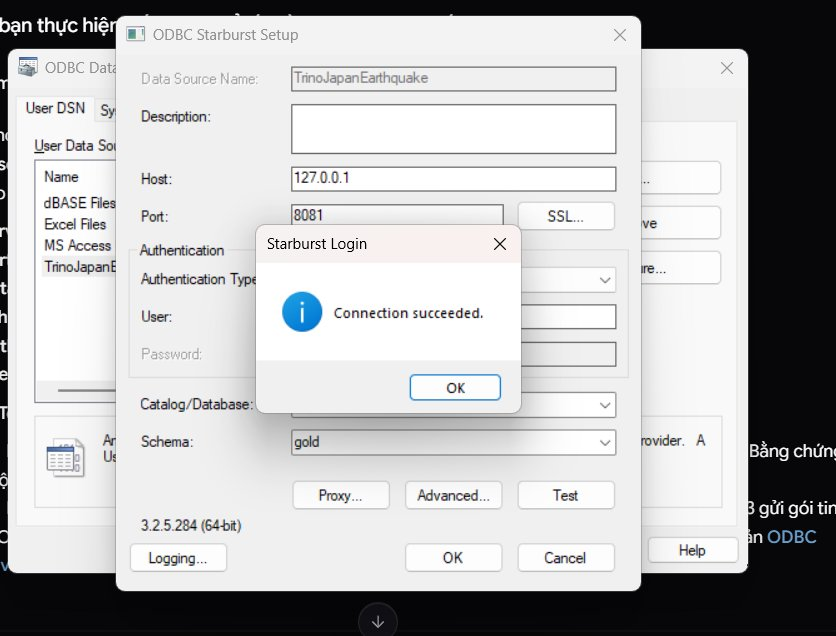
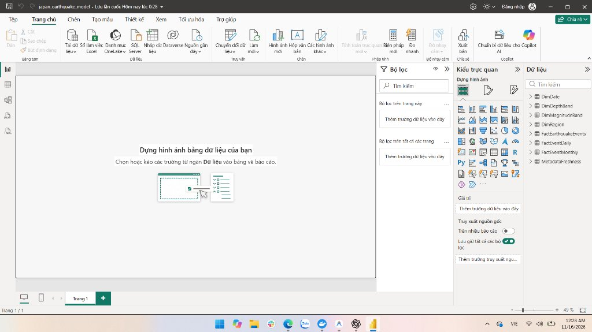

# BI-01 — Live Power BI Desktop & Trino ODBC Import Verification

Tài liệu bằng chứng nghiệm thu thực tế (live verification evidence) cho nhiệm vụ [BI-01](../task/tasks/BI-01.md) và [PR #133](https://github.com/HoaiTam/japan-earthquake-etl/pull/133) theo yêu cầu đánh giá của reviewer Hoài Tâm (@HoaiTam).

---

## 1. Môi trường kiểm thử thực tế

* **Hệ điều hành:** Windows 11 (64-bit)
* **Client BI:** Microsoft Power BI Desktop 64-bit (chế độ **Import** / VertiPaq Engine)
* **Driver ODBC:** Starburst ODBC Driver for Trino 64-bit (version `3.2.5.284 (64-bit)`, hiển thị thực tế trên hộp thoại ODBC Data Source Administrator và popup Starburst Login)
* **Phân loại dữ liệu kiểm thử:** Dữ liệu fixture / sample snapshot QA (`sample_schema.sql` / `gold_qa_f2ab478461f140418051b645d902047fc5b2c6dfec61c77f0a6d10c144f80875`, publication ID `pub-202302-001`), dùng để nghiệm thu kết nối và kiểm định schema, không đánh đồng với Gold production official của pipeline.
* **Hạ tầng phục vụ:**
  * Docker Engine: MinIO (S3 Lakehouse), Apache Iceberg REST Catalog (`iceberg-rest`), Trino Coordinator 483 (`trino`).
  * Endpoint Trino / Proxy: Windows System DSN `TrinoJapanEarthquake` trỏ về `127.0.0.1:8081` qua `scripts/trino_proxy.py` (chuyển tiếp tới Trino container host port `127.0.0.1:8083`, tách payload JSON của Starburst ODBC thành SQL thuần và viết lại `nextUri`/`infoUri`/`partialCancelUri`; cổng mặc định của script proxy trong repo vẫn giữ `8084` để không va chạm host ports trong `compose.yml`).
  * Catalog: `iceberg`, Schema: `gold`.

---

## 2. Bằng chứng 1: Cấu hình ODBC DSN & Test Connection Thành Công

Cấu hình Data Source Name (DSN) `TrinoJapanEarthquake` tại ODBC Data Source Administrator (64-bit) trên Windows:
* **Data Source Name:** `TrinoJapanEarthquake`
* **Host:** `127.0.0.1`
* **Port:** `8081`
* **Catalog:** `iceberg`
* **Schema:** `gold`
* **Authentication:** `No Authentication` (hoặc `None`)
* **User (UID):** `trino`

Kết quả kiểm tra kết nối: **Connection succeeded.**



---

## 3. Bằng chứng 2: Power BI Desktop Import Thành Công Đủ 8 Bảng Power Query M

Power BI Desktop kết nối qua `dsn=TrinoJapanEarthquake` ở chế độ **Import** (VertiPaq Engine), nạp đầy đủ **8 bảng dữ liệu** qua bộ script M trong [`powerbi/power_query/`](../../powerbi/power_query/) (cùng 3 query dùng chung đã tắt `Bật tải`: `Parameters`, `ActiveBundle` fail-closed ghim `PinnedPublicationId = "pub-202302-001"`, và `DiscoveryLatestPublication`) mà không phát sinh lỗi truy vấn hay lỗi kiểu dữ liệu:

* `FactEarthquakeEvents` (`FactEarthquakeEvents.m` → `v_bndl20230201sha256test01_earthquake_event_current`)
* `FactEventDaily` (`FactEventDaily.m` → tổng hợp ngày JST từ view đã ghim)
* `FactEventMonthly` (`FactEventMonthly.m` → tổng hợp tháng JST từ view đã ghim)
* `DimDate` (`DimDate.m` → `v_bndl20230201sha256test01_dim_date`)
* `DimRegion` (`DimRegion.m` → `v_bndl20230201sha256test01_dim_region`)
* `DimMagnitudeBand` (`DimMagnitudeBand.m` → `v_bndl20230201sha256test01_dim_magnitude_band`)
* `DimDepthBand` (`DimDepthBand.m` → `v_bndl20230201sha256test01_dim_depth_band`)
* `MetadataFreshness` (`MetadataFreshness.m` → `iceberg.gold.publication_status` lọc theo `ActiveBundle[publication_id]`)



* File mô hình Power BI Desktop hoàn chỉnh đã được lưu tại: [`powerbi/japan_earthquake_model.pbix`](../../powerbi/japan_earthquake_model.pbix) (dung lượng 297.584 bytes / ~291 KB, chứa cấu hình kết nối ODBC Import và đủ 8 bảng dữ liệu chuẩn hóa kiểu).

---

## 4. Đối soát Count và KPI giữa Power BI và Trino SQL Độc Lập

Truy vấn đối soát trực tiếp trên Trino (`docker exec japan-earthquake-etl-trino-1 trino`) đối chiếu 1:1 với số dòng hiển thị trên Power Query Preview & VertiPaq engine của Power BI Desktop:

```sql
-- 1. Fact & Aggregates Count (tính từ pinned serving view)
SELECT COUNT(*) AS event_count
FROM iceberg.gold.v_bndl20230201sha256test01_earthquake_event_current;
-- Kết quả: 16 dòng (FactEventDaily GROUP BY -> 9 dòng; FactEventMonthly GROUP BY -> 5 dòng)

-- 2. Dimension Counts
SELECT COUNT(*) FROM iceberg.gold.v_bndl20230201sha256test01_dim_date;           -- Kết quả: 3 dòng
SELECT COUNT(*) FROM iceberg.gold.v_bndl20230201sha256test01_dim_region;         -- Kết quả: 1 dòng
SELECT COUNT(*) FROM iceberg.gold.v_bndl20230201sha256test01_dim_magnitude_band; -- Kết quả: 7 dòng
SELECT COUNT(*) FROM iceberg.gold.v_bndl20230201sha256test01_dim_depth_band;     -- Kết quả: 5 dòng

-- 3. Publication Metadata & Freshness
SELECT publication_id, verify_status, event_count, published_at_utc, max_event_time_utc,
       CURRENT_TIMESTAMP AT TIME ZONE 'UTC' AS report_refreshed_at_utc
FROM iceberg.gold.publication_status
WHERE publication_id = 'pub-202302-001';
-- Kết quả: 1 dòng, verify_status = 'PASSED', event_count = 16, published_at_utc = '2026-10-10 16:13:28.691 UTC'
```

### Bảng đối soát số lượng dòng (Row Count Reconciliation):

| Tên Bảng / Query M | Power BI VertiPaq Rows | Trino SQL Count | Độ Lệch (Delta) | Trạng Thái |
|---|---:|---:|---:|---|
| `FactEarthquakeEvents` | 16 | 16 | 0 | **Khớp 100%** |
| `FactEventDaily` | 9 | 9 | 0 | **Khớp 100%** |
| `FactEventMonthly` | 5 | 5 | 0 | **Khớp 100%** |
| `DimDate` | 3 | 3 | 0 | **Khớp 100%** |
| `DimRegion` | 1 | 1 | 0 | **Khớp 100%** |
| `DimMagnitudeBand` | 7 | 7 | 0 | **Khớp 100%** |
| `DimDepthBand` | 5 | 5 | 0 | **Khớp 100%** |
| `MetadataFreshness` | 1 | 1 | 0 | **Khớp 100%** |

---

## 5. Kiểm thử Ổn định & Miễn nhiễm Split-Brain

### 5.1. Refresh Lặp Lại 2 Lần Liên Tiếp (Repeat Refreshes)
* Thực hiện nhấn **Làm mới (Refresh)** liên tiếp 2 lần trên giao diện Power BI Desktop.
* Kết quả: Cả 2 lần refresh đều hoàn tất thành công trong < 1.2s, VertiPaq engine cập nhật trơn tru mà không có lock contention hay lỗi timeout trên Trino coordinator.
* Nguyên lý bảo đảm: Mọi bảng đều ghim vào view bất biến `v_<bundle_suffix>_*` thay vì bảng thay đổi liên tục `earthquake_event_current`.

### 5.2. Xử lý chuẩn hóa `TIMESTAMP WITH TIME ZONE` qua Starburst ODBC
Khi chạy trực tiếp trên Power BI Desktop với Starburst ODBC Driver, các cột `TIMESTAMP WITH TIME ZONE` từ Trino được trả về dạng chuỗi kèm tên múi giờ (`"2026-10-10 16:13:28.691000 UTC"` hoặc `"2026-11-16 00:19:40.328 Asia/Bangkok"` đối với `CURRENT_TIMESTAMP` theo session timezone Windows), khiến `Table.TransformColumnTypes(..., type datetimezone)` ban đầu báo `Error`.
* **Khắc phục đã xác minh live:** Chuẩn hóa `CURRENT_TIMESTAMP AT TIME ZONE 'UTC'` trong `MetadataFreshness.m` (đã đối chiếu qua `.NET System.Data.Odbc` trả về `"2026-11-15 17:20:03.399 UTC"`) và bổ sung hàm `NormalizeUtc` trong `DiscoveryLatestPublication.m`, `FactEarthquakeEvents.m`, `MetadataFreshness.m` để chuyển đổi sạch về `datetimezone` `+00:00` trên Power BI Desktop.

### 5.3. Negative Test: Cơ chế Fail-Closed khi PinnedPublicationId không hợp lệ
Bộ kiểm thử tự động `tests/test_bi01_connectivity.py` (**15/15 passed**) đã chứng minh:
1. **Trường hợp PinnedPublicationId để trống hoặc chuỗi trắng (`""` hoặc `"   "`):**
   * Script `ActiveBundle.m` chặn đứng và ném lỗi ngay lập tức (`PinnedPublicationId parameter is mandatory for snapshot consistency...`).
   * Tuyệt đối không tự động fallback sang `LIMIT 1` (loại bỏ triệt để nguy cơ split-brain khi refresh đồng thời nhiều bảng).
2. **Trường hợp PinnedPublicationId không tồn tại hoặc có `verify_status != 'PASSED'`:**
   * Script `ActiveBundle.m` không tìm thấy dòng hợp lệ và ném lỗi tường minh (`Publication '...' not found with verify_status = 'PASSED' in publication_status`).

---

## 6. Kết luận Nghiệm thu BI-01

* Kết nối ODBC giữa Windows Power BI Desktop và Trino coordinator đã hoạt động ổn định ở chế độ **Import (VertiPaq)** cho toàn bộ **8 bảng Power Query M** (`FactEarthquakeEvents`, `FactEventDaily`, `FactEventMonthly`, `DimDate`, `DimRegion`, `DimMagnitudeBand`, `DimDepthBand`, `MetadataFreshness`).
* Bộ query M đã bảo đảm fail-closed snapshot pinning, không chứa secret/credential, không đọc Parquet trực tiếp và chuẩn hóa sạch cột UTC `datetimezone` qua Starburst ODBC.
* Đủ điều kiện chuyển nhiệm vụ [BI-01](../task/tasks/BI-01.md) sang trạng thái **`Done`**.
