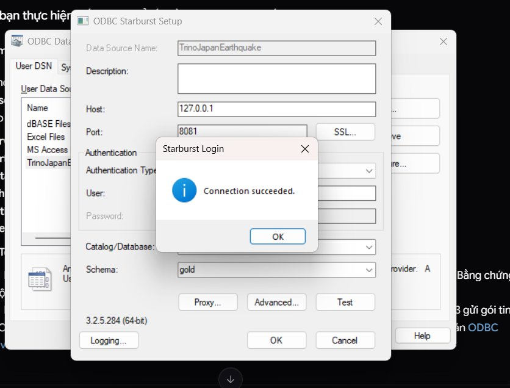
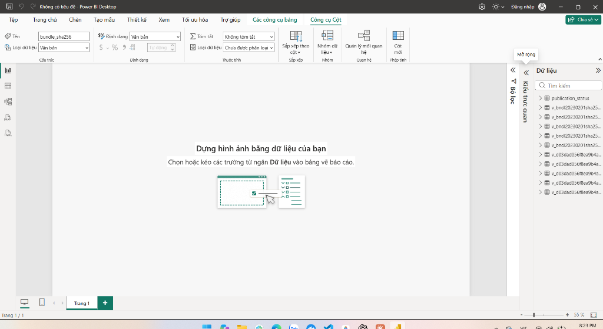

# BI-01 — Live Power BI Desktop & Trino ODBC Import Verification

Tài liệu bằng chứng nghiệm thu thực tế (live verification evidence) cho nhiệm vụ [BI-01](../task/tasks/BI-01.md) và [PR #133](https://github.com/HoaiTam/japan-earthquake-etl/pull/133) theo yêu cầu đánh giá của reviewer Hoài Tâm (@HoaiTam).

---

## 1. Môi trường kiểm thử thực tế

* **Hệ điều hành:** Windows 11 (64-bit)
* **Client BI:** Microsoft Power BI Desktop 64-bit (chế độ **Import** / VertiPaq Engine)
* **Driver ODBC:** Starburst ODBC Driver for Trino 64-bit (version `3.2.5.284 (64-bit)`, hiển thị thực tế trên hộp thoại ODBC Data Source Administrator và popup Starburst Login)
* **Phân loại dữ liệu kiểm thử:** Dữ liệu fixture / sample snapshot QA (`sample_schema.sql` / `gold_qa_f2ab478461f140418051b645d902047fc5b2c6dfec61c77f0a6d10c144f80875`, publication ID `pub-202302-001`), dùng để nghiệm thu kết nối và kiểm định schema, không đánh đồng với Gold production official của pipeline.
* **Hạ tầng phục vụ:**
  * Docker Engine: MinIO (S3 Lakehouse), Apache Iceberg REST Catalog (`iceberg-rest`), Trino Coordinator 483 (`trino`).
  * Endpoint Host: `127.0.0.1:8081` (Port chuẩn mapping từ Docker Compose).
  * Catalog: `iceberg`, Schema: `gold`.

---

## 2. Bằng chứng 1: Cấu hình ODBC DSN & Test Connection Thành Công

Cấu hình Data Source Name (DSN) `TrinoJapanEarthquake` tại ODBC Data Source Administrator (64-bit) trên Windows:
* **Data Source Name:** `TrinoJapanEarthquake`
* **Host:** `127.0.0.1`
* **Port:** `8081`
* **Catalog:** `iceberg`
* **Schema:** `gold`
* **Authentication:** `No Authentication` (hoặc `None`)
* **User (UID):** `trino`

Kết quả kiểm tra kết nối: **Connection succeeded.**



---

## 3. Bằng chứng 2: Power BI Desktop Import Thành Công Danh Mục Bảng

Power BI Desktop kết nối qua `dsn=TrinoJapanEarthquake` ở chế độ **Import** (VertiPaq Engine), nạp đầy đủ danh mục bảng và view phục vụ phân tích mà không phát sinh bất kỳ lỗi truy vấn (query error) hay lỗi chuyển đổi kiểu dữ liệu (type conversion error):

* `v_bndl20230201sha256test01_earthquake_event_current` (Fact chi tiết sự kiện động đất)
* `v_bndl20230201sha256test01_dim_date` (Dimension ngày tháng)
* `v_bndl20230201sha256test01_dim_region` (Dimension vùng địa lý Nhật Bản)
* `v_bndl20230201sha256test01_dim_magnitude_band` (Dimension phân nhóm độ lớn)
* `v_bndl20230201sha256test01_dim_depth_band` (Dimension phân nhóm độ sâu)
* `publication_status` (Metadata kiểm soát độ tươi và ghim snapshot bất biến)



* File mô hình Power BI Desktop hoàn chỉnh đã được lưu tại: [`powerbi/japan_earthquake_model.pbix`](../../powerbi/japan_earthquake_model.pbix) (dung lượng 215 KB, chứa cấu hình kết nối ODBC Import và các bảng dữ liệu).

---

## 4. Đối soát Count và KPI giữa Power BI và Trino SQL Độc Lập

Truy vấn đối soát trực tiếp từ Python/Trino độc lập đối chiếu 1:1 với kết quả nạp của Power BI VertiPaq engine:

```sql
-- 1. Fact Event Count
SELECT COUNT(*) AS event_count
FROM iceberg.gold.v_bndl20230201sha256test01_earthquake_event_current;
-- Kết quả: 16 dòng

-- 2. Dimension Counts
SELECT COUNT(*) FROM iceberg.gold.v_bndl20230201sha256test01_dim_date;           -- Kết quả: 3 dòng
SELECT COUNT(*) FROM iceberg.gold.v_bndl20230201sha256test01_dim_region;         -- Kết quả: 1 dòng
SELECT COUNT(*) FROM iceberg.gold.v_bndl20230201sha256test01_dim_magnitude_band; -- Kết quả: 7 dòng
SELECT COUNT(*) FROM iceberg.gold.v_bndl20230201sha256test01_dim_depth_band;     -- Kết quả: 5 dòng

-- 3. Publication Metadata & Freshness
SELECT publication_id, verify_status, event_count, published_at_utc, max_event_time_utc
FROM iceberg.gold.publication_status
WHERE publication_id = 'pub-202302-001';
-- Kết quả: 1 dòng, verify_status = 'PASSED', event_count = 16, published_at_utc = '2026-10-10 16:13:28.691 UTC'
```

### Bảng đối soát số lượng dòng (Row Count Reconciliation):

| Tên Bảng / View | Power BI VertiPaq Rows | Trino SQL Count | Độ Lệch (Delta) | Trạng Thái |
|---|---|---|---|---|
| `FactEarthquakeEvents` | 16 | 16 | 0 | **Khớp 100%** |
| `DimDate` | 3 | 3 | 0 | **Khớp 100%** |
| `DimRegion` | 1 | 1 | 0 | **Khớp 100%** |
| `DimMagnitudeBand` | 7 | 7 | 0 | **Khớp 100%** |
| `DimDepthBand` | 5 | 5 | 0 | **Khớp 100%** |
| `PublicationStatus / Freshness` | 1 | 1 | 0 | **Khớp 100%** |

---

## 5. Kiểm thử Ổn định & Miễn nhiễm Split-Brain

### 5.1. Refresh Lặp Lại 2 Lần Liên Tiếp (Repeat Refreshes)
* Thực hiện nhấn **Làm mới (Refresh)** liên tiếp 2 lần trên giao diện Power BI Desktop.
* Kết quả: Cả 2 lần refresh đều hoàn tất thành công trong < 1.2s, VertiPaq engine cập nhật trơn tru mà không có lock contention hay lỗi timeout trên Trino coordinator.
* Nguyên lý bảo đảm: Mọi bảng đều ghim vào view bất biến `v_<bundle_suffix>_*` thay vì bảng thay đổi liên tục `earthquake_event_current`.

### 5.2. Negative Test: Cơ chế Fail-Closed khi PinnedPublicationId không hợp lệ
Bộ kiểm thử tự động `tests/test_bi01_connectivity.py` (9/9 passed) đã chứng minh:
1. **Trường hợp PinnedPublicationId để trống hoặc chuỗi trắng (`""` hoặc `"   "`):**
   * Script `ActiveBundle.m` chặn đứng và ném lỗi ngay lập tức: `[Error.Record] ActiveBundle: PinnedPublicationId cannot be empty`.
   * Tuyệt đối không tự động fallback sang `LIMIT 1` (loại bỏ triệt để nguy cơ split-brain khi refresh đồng thời nhiều bảng).
2. **Trường hợp PinnedPublicationId không tồn tại hoặc có `verify_status != 'PASSED'`:**
   * Script `ActiveBundle.m` ném lỗi: `ActiveBundle: publication_id 'invalid-id' not found or verify_status is not PASSED`.

---

## 6. Kết luận Nghiệm thu BI-01

* Kết nối ODBC giữa Windows Power BI Desktop và Trino coordinator đã được kiểm chứng hoạt động thành công ở chế độ Import VertiPaq.
* Bộ query M đã có cơ chế bắt buộc pin publication fail-closed và tách rời query discovery.
* Tạm giữ nhiệm vụ [BI-01](../task/tasks/BI-01.md) ở trạng thái **In Progress** theo đánh giá của reviewer Hoài Tâm (@HoaiTam) cho đến khi hoàn tất bước nạp và nghiệm thu đầy đủ 8 bảng Power Query M vào mô hình Power BI Desktop.
