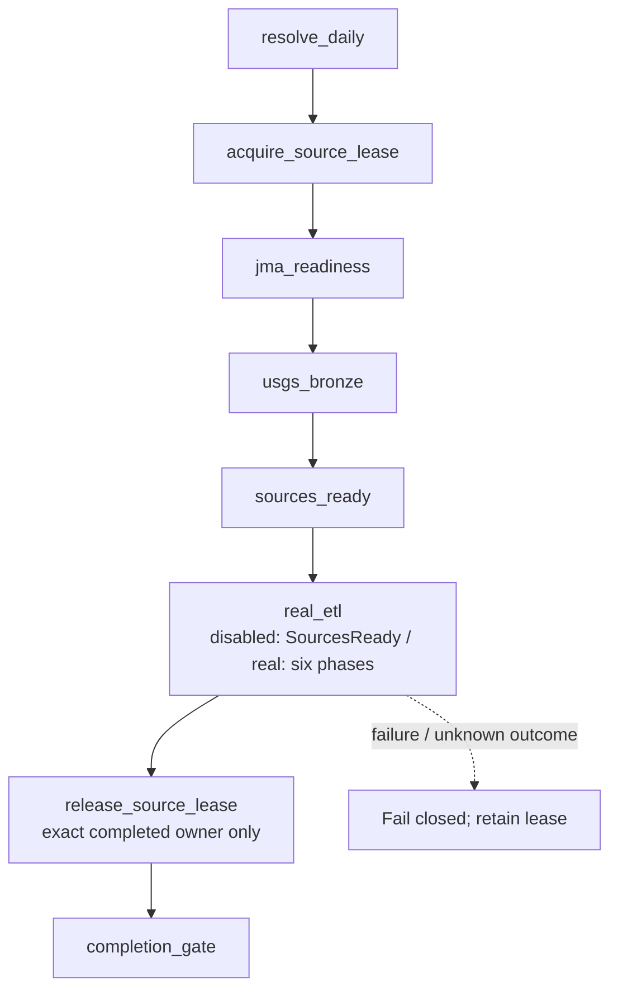

# Luồng ETL hằng ngày

Cập nhật DOC-01 **19/10/2026**. Đọc cùng [kiến trúc](../SYSTEM_ARCHITECTURE.md),
[ORC-07](../runbooks/ORC-07_REAL_ETL.md) và [QA-01](../runbooks/QA-01_DAILY_E2E.md).

## 1. Entry point và trạng thái

`orc_02_daily_sources` là cron owner duy nhất: mặc định `15 7 * * *`,
Asia/Ho_Chi_Minh, catchup false, max_active_runs/tasks=1, paused upon creation.
USGS data window dùng UTC. JMA là archives có version, không phải daily event API.

- ORC07_DAILY_MODE=disabled (default): SourcesReady/published=false.
- Mode real + exact eligible full-month request: sáu Java phases đến Published.
- ORC-07 có bounded real DAG.test; **QA-01 scheduled deployment chưa PASSED**.
- orc_01_etl_pipeline là skeleton/mock; MockComplete không thay Published.

## 2. Ba phạm vi thời gian

| Phạm vi | Ý nghĩa |
|---|---|
| Airflow data interval | Khoảng lịch ổn định của DagRun, kết thúc ở biên cron |
| USGS query [start,end) | Ba ngày UTC đã hoàn tất gần nhất, clip ở seed 2023-01-01; API endtime = exclusive end −1ms |
| Gold affected months | Tập tháng UTC đủ state/coverage được resolver chứng nhận; không chỉ delta ba ngày |

Ví dụ interval Airflow kết thúc 2023-10-01T00:15:00Z: target day 30/09 UTC,
query USGS `[2023-09-28T00:00:00Z,2023-10-01T00:00:00Z)` với overlap=3.
Đây là ví dụ tính window, chưa phải request Published đủ tháng.
Revision cũ hơn overlap cần scoped backfill, không coi ba ngày bắt mọi sửa đổi.
Rule đầy đủ: [source coverage](../specs/SOURCE_COVERAGE.md),
[USGS request](../specs/USGS_REQUEST_CONTRACT.md).

## 3. Graph đang có

Đây là 8 tasks; sáu phases real nằm trong task real_etl. Dùng receipts/artifacts
để xác định phase lỗi, không nhầm chúng với sáu run riêng.

## 4. Làm gì, gồm gì, dùng để làm gì?

| Bước | Thực hiện / output | Cổng an toàn |
|---|---|---|
| Resolve | Exact dag/run, interval/profile; USGS overlap, JMA watchlist | Daily conf rỗng, không arbitrary historical scope |
| Lease | Whole-source writer lock đúng owner | Không tranh daily/backfill hoặc tự lấy lease hết hạn |
| JMA readiness | HEAD/version/checksum audit; reuse hoặc ingest changed release | Raw ZIP + manifest BronzeReady; chưa là full historical coverage |
| USGS Bronze | Query/fetch/validate/write/readback GeoJSON/manifest | HTTP bounded retry; invalid/quarantine không đi Silver |
| SourcesReady | Summary hai nguồn, manifest/raw SHA, query context, changed years | Không Published; chưa đủ ML upstream evidence |
| Silver real | Exact pins + baseline, parse/quality, revisions, links/memberships, full-month proof | COMPLETE_MONTHS; reconciliation; không overwrite tháng bằng delta |
| Gold real | Sáu bảng Iceberg, scope/baseline/snapshot journal | COMMITTED/published=false, chưa mở serving |
| Verify/publish | Trino verify counts/keys/fields/lineage/scope/dimensions trên pinned snapshots | Blockers đạt mới có versioned views/PASSED row và Published |
| Release/completion | Execution/summary SHA của chính operation, exact owner | Summary cũ không release attempt mới đang lỗi |

JMA ZIP vào Bronze nguyên bản; đọc member ZIP để validate/parse không thay raw
bằng dữ liệu đã lọc. Silver thông thường có reject dataset; ORC-06 full-month
parser v1 fail-closed nếu có parser rejects. Không bỏ event vì thiếu enrichment.

## 5. Count và lineage

Giữ riêng full Bronze count, selected records, outside temporal selection,
parser rejects, repeated observation IDs, revisions ngoài affected months,
current/history, links, memberships và canonical. Không trừ tổng link rows khỏi
raw count. Overlap không được làm tăng canonical chỉ vì tải lại observation.

Evidence chain: dag_id/run_id → source summary SHA → context/operation →
Bronze pins → Silver bundle/full-month registry → six Gold snapshots →
Trino verification → publication_id.

Keys dưới configured Silver prefix: real-etl/operation, full-month/operation,
bundles/operation, gold-commits/operation, gold-verification/operation.
Không dùng wildcard/latest hoặc ghép smoke namespace để nhận E2E Passed.

## 6. Chạy và nghiệm thu

Chuẩn bị/start Docker riêng theo [local runbook](../LOCAL_OPERATIONS_RUNBOOK.md).
`make test-real-etl` là regression offline; `make qa-real-etl` là opt-in bounded
QA có thể ingest/ghi QA namespace, không phải read-only collector hoặc cron.
Đọc yêu cầu image/captures/lease ở ORC-07 trước khi chạy.

QA-01 có `make test-qa-01` và smoke collector cho exact scheduled run từ UI.
Preflight stale image dừng trước exec; SourcesReady-only báo NOT_READY.
[Evidence QA-01](../evidence/QA-01.md) ghi rõ deployment còn thiếu gì.

Sau Published, MLI-02 riêng biệt pin dataset; ETL không fit HDBSCAN, trigger
Colab hoặc chờ experiment. Static report là Core, Power BI refresh là Stretch.

## 7. Giới hạn và recovery

ORC-06/07 v1 chỉ hỗ trợ closed months đủ proof/halo, JMA inventory đến 2023.
QA-01 bổ sung [thiết kế current-month/as-of-cutoff](../specs/CURRENT_MONTH_AS_OF_CUTOFF.md)
ngày 22/10, planner giữ DESIGN_ONLY; [Source/Silver component standalone](../runbooks/CURRENT_MONTH_SOURCE_SILVER.md)
đã có nhưng chưa nối cron/Gold. Work packages còn lại/JMA sau baseline chưa có
task ID/effort riêng. Không bật real daily 2026 bằng historical request để bypass
coverage. QA-01 còn scheduled acceptance; QA-02/03/04 đã Done theo bounded
runtime evidence v1, không chứng nhận policy current-month v2.
[Known issues](../KNOWN_ISSUES.md) dẫn đúng task.
Fail/timeout giữ evidence/lease; không clear/mark-success/retry write mù.
Xem [backfill/recovery](./BACKFILL_AND_RECOVERY.md).
