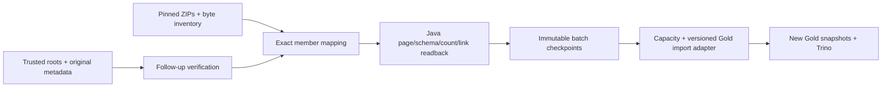

# DAT-03 — Portable readback tiết kiệm dung lượng

## Phạm vi và các công cụ

1. `verify-dat03-followup.py`: kiểm original commit/identity/publication bằng request và independent data ZIP đã pin; tách identity payload digest khỏi raw-file SHA.
2. `plan-dat03-portable-silver.py`: tạo mapping original bundle/dataset manifests sang member byte-identical trong ZIP. Python chỉ xử lý metadata, không ETL Parquet.
3. `PortableSilverReadback`: Java kiểm schema, footer/decoded counts, giải mã mọi trang Parquet, kiểm current observation IDs, memberships và source-link references. Không cần Spark session, không bung dataset hoặc ghi MinIO.
4. `readback-dat03-worker.py`: chạy Java tuần tự, tối đa4run groups/12affected months mỗi batch, heap1536MiB,2giờ/phiên, reserve4GiB đĩa host. Nhóm nguồn quá12tháng bị chặn, không cắt âm thầm. Không sampling/truncate.



Hai bước cuối không được chứng nhận bởi readback. Không tạo `_SUCCESS`/identity marker giả cho source bundle hoặc copy snapshot IDs để coi là catalog đã restore.

## Input và checkpoint

- Requests gốc: [Trang](../../config/research/dat03_lineage_rosy179_followup_20261114.json), [Trí](../../config/research/dat03_lineage_ThanhTris_followup_20261114.json).
- Follow-up plan `dat03-followup-verification-plan-v1`: owner, request path/SHA, metadata archives path/SHA, independent data archive path/SHA.
- Preparation config `dat03-portable-preparation-v1`: follow-up plan path/SHA, roots path/SHA, inventory path/SHA, exact run IDs, payload archive path/SHA.
- Java plan `dat03-portable-silver-readback-v1`: original metadata base64, bundle/dataset pins, exact payload URI/member/archive SHA. Không serialize lại bytes nguồn để thay checksum.
- Checkpoint nối previous checkpoint SHA, config/plan/receipt SHA và tháng đã kiểm. Chỉ là readback acceptance, không ETL/catalog rollout acceptance.

Actual inputs/configs ở ignored `staging/dat03-integration-20261114/` trên máy owner. Máy khác cần tải đúng artifacts/pins trước; không commit ZIP/Parquet/JAR/private logs hoặc tin checksum tự khai. [Evidence và pins](../evidence/DAT-03_PORTABLE_READBACK_20261114.md).

## Kiểm thử và chuẩn bị classpath

```bash
make test-dat03-lineage test-dat03-payload-inventory test-dat03-portable
./mvnw --batch-mode --no-transfer-progress -pl spark dependency:build-classpath -Dmdep.outputFile=target/portable-classpath.txt -DincludeScope=test
```

Các test không start service, build Docker hoặc chạy ETL. Runtime Spark dùng JDK17; pure-JVM tests cũng đã chạy host JDK26/release17, không suy host tests thành Spark17 acceptance.

## Chạy lại actual inputs trên máy owner

```bash
python3 -B scripts/readback-dat03-worker.py --config staging/dat03-integration-20261114/rosy-prepare-first.json --config-sha256 f2d9fdc3ab74926a7c3dd797727ad11db999568201553a0e23873fc5e20e2266 --start-month 2018-10 --end-month 2023-12 --classpath-file spark/target/portable-classpath.txt --output staging/dat03-integration-20261114/rosy-repeat-readback
python3 -B scripts/readback-dat03-worker.py --config staging/dat03-integration-20261114/tri-prepare-first.json --config-sha256 57b76aa26d8c2b8b984b4d8f4ad4b9afc7a707502ff33f62071053afbd885207 --start-month 2013-08 --end-month 2018-09 --classpath-file spark/target/portable-classpath.txt --output staging/dat03-integration-20261114/tri-repeat-readback
```

Chạy hai lệnh tuần tự, dùng output mới. Controller chọn toàn range từ bundle roots đã pin, kiểm0gap/0overlap trước chạy, không scan MinIO/latest. `completed.json` và từng checkpoint chỉ được tạo sau Java exit0 và receipt khớp. Lỗi/timeout giữ `failed.json`, checkpoint và logs; không auto retry/skip/overwrite. Chưa có resume ETL trong tool này. Muốn lặp readback thuần đọc, kiểm nguyên nhân và tạo output mới.

## Capacity trước Gold import

`PortableGoldCapacityJob` chỉ đọc publication/snapshot đã pin, tạo engineering stress **trong Spark**, kiểm count/unique và lặp đúng fingerprint của `GoldIcebergWriter`. Synthetic stress không phải research rows; không CREATE/ALTER/INSERT/MERGE hoặc tạo snapshot.

Publication do Trino ghi có thể dùng `DELTA_LENGTH_BYTE_ARRAY`, không tương thích vectorized reader hiện tại. Probe dùng **session-only** `spark.sql.iceberg.vectorization.enabled=false`, theo [Iceberg Spark configuration](https://iceberg.apache.org/docs/latest/spark-configuration/). Không ALTER table properties, đổi source pins hoặc hạ quality gate.

Runner nằm riêng dưới staging trong scheduler đang chạy, không thay deployed DAG runner. Mỗi attempt giữ request/runner SHA, private stdout/stderr và execution receipt; failed attempt không bị ghi đè. Kết quả/gate thực tế theo evidence, không dùng “Spark đã khởi động” làm PASS.

Attempt v2 ngày14/11 đã timeout trong startup Spark/BlockManager, chưa có capacity
report. Không tự retry, chạy bridge probe hoặc ghi Gold; giữ checkpoint để chẩn
đoán startup trước. Không suy từ lỗi RPC rằng dataset hỏng hoặc chắc chắn thiếu
RAM. Deadline controller là giới hạn an toàn, không phải acceptance time budget
đã được chứng minh cho full workload.

Worker Bronze keys khác owner keys. Trước importer cần mapping provenance có
version, xác minh physical bytes và source identity/window/release, giữ original
URIs; không tạo success markers giả cho các source bundles chưa restore.

## Phần còn thiếu thuộc DAT-03

- Versioned Gold import adapter: baseline163tháng + worker125tháng, lineage, boundary/revision/source-link checks và own lease/checkpoint.
- Actual six-table Gold commit/publish, Trino/rerun trên namespace được duyệt `iceberg.dat03_unified_20261114`, chỉ sau test/capacity/provenance gates. Không sửa namespace cũ.
- Hai official ML exports, EXPORTED lifecycle, loader, immutable kit và receipts ba máy thật.

Giữ DAT-03 **In Progress**. Readback không tự cấp portable_import_ready, official_export_ready hoặc full transitive closure.
