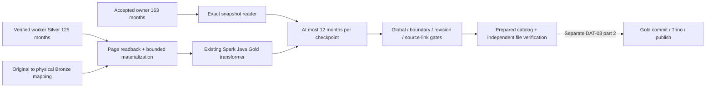

# DAT-03 — Portable import / prepared catalog v1

## Mục đích và ranh giới

Phần 1 của [DAT-03](../task/tasks/DAT-03.md) ghép baseline đã Published trên máy
coordinator với Silver portable của hai worker thành **input chuẩn bị cho Gold**.
Đây không phải phục hồi Iceberg graph từ máy worker hoặc Published catalog mới.

| Input | Tháng UTC | Bằng chứng gốc |
| --- | --- | --- |
| Baseline owner | 2000-01..2013-07, 163 tháng | CAS accepted prefix, own release, commit/publication, sáu snapshot/count/content fingerprints, receipt-bound FullMonthReady/Silver bundle gốc |
| ThanhTris | 2013-08..2018-09, 62 tháng | completed/readback/checkpoint SHA chain, original bundle/dataset metadata, payload ZIP pins |
| rosy179 | 2018-10..2023-12, 63 tháng | cùng contract worker; không coi journal snapshot IDs là local physical snapshots |

Request phải phủ đúng 288 tháng liên tục, không overlap/gap. REPRODUCTION gồm
225 tháng 2000-01..2018-09; EXTENSION gồm 63 tháng 2018-10..2023-12. Không nới
ranh giới PRE/POST của nghiên cứu, không dùng pilot 279 dòng thay dữ liệu thật.

## Contract có version

- `dat03-portable-import-preparation-v1`: host config với exact CAS observation,
  baseline session, trusted completed SHA từng worker, Bronze relocation plan và
  runner. File phụ thuộc môi trường nằm ngoài Git, không chứa credential.
- `dat03-portable-import-v1`: immutable request, `PREPARE_ONLY`, run context,
  cutoff giữ nguyên, runner SHA, baseline int64 pins/counts và từng worker plan
  SHA, original-plan SHA, months/run IDs/counts. Không nhận caller readiness flags.
- `dat03-portable-source-coverage-v1`: 288 tháng và exact physical manifests;
  JMA 2000..2024, mỗi December UTC cần thêm archive JST năm kế tiếp; USGS 12
  cửa sổ 2023 đã pin, giữ seed/halo 16 giây, gồm dependency December 2022.
- `dat03-prepared-catalog-v1`: `PREPARED`, sáu logical Gold datasets, auxiliary
  source-link dataset, SHA-chain batch checkpoints, request/coverage/provenance/
  reconciliation refs và từng Parquet file SHA/size/footer row count.

Snapshot IDs luôn là int64; không chuyển qua JavaScript Number. Input gốc không
bị serialize lại để thay pin. Derived plan chỉ thay đường dẫn ZIP vật lý trong
container riêng, vẫn giữ original metadata bytes, original URI và original-plan SHA.

## Luồng thực hiện

Chỉ Spark Java biến đổi dữ liệu. Python kiểm metadata, stage input, launch và
theo dõi process; không dùng pandas/Python để dedup ETL. Không replay source ETL.

Baseline chia 14 batch, worker theo 13 batch đã đọc trước: tối đa 12 tháng và
4 source runs mỗi worker batch. Local dependencies dùng `local:/`, heap driver
768 MiB/direct memory 256 MiB; session tối đa 6.000 giây, không chạy song song.
Reader compatibility chỉ nằm trong session, không ALTER source table properties.

Materializer chỉ ghi exact referenced parts vào staging mới; kiểm SHA/size sau
copy. Golden fields `gold_run_id` và `record_updated_at_utc` được chuẩn hóa theo
request cố định; baseline/Silver gốc giữ nguyên. Worker dùng lại GoldEventTransformer.
Không giả `_SUCCESS`, `SilverReady`, `FullMonthReady` hoặc legacy 288 checkpoints.

## Global quality và revision

- Đọc **toàn bộ** prepared rows; count phải khớp input đã pin, không sampling.
- Loại exact-row duplicates và ghi rõ input/deduplicated counts. Cùng logical ID
  nhưng nội dung khác nhau là conflict, không tự chọn một bản.
- Silver đã chọn revision theo contract nguồn. Nếu nhiều current observations
  cùng `(source_system, source_record_key)` xuất hiện sau ghép, fail closed:
  `GLOBAL_REVISION_CONFLICT_REQUIRES_SOURCE_RESOLUTION`. Gold thiếu trường để
  tự quyết định revision hợp lệ; không dùng ngày ingest để chọn bừa latest.
- Canonical/observation IDs duy nhất, không orphan, đúng một primary/canonical,
  primary ID/source count/USGS-JMA flags khớp bridge.
- Link IDs duy nhất, endpoints tồn tại; ACCEPTED phải cùng canonical, REJECTED/
  AMBIGUOUS không được collapse. Bridge chỉ tham chiếu ACCEPTED link có đúng
  endpoint; supporting member cần accepted link. `accepted_links = bridge - events`.
- Dimensions distinct theo logical key, nội dung khác trên cùng key bị chặn.
- Coverage/SHA/file footer/checkpoint chain phải đạt trước manifest `PREPARED`.

## Output và lifecycle

Root riêng: `/opt/pipeline/staging/dat03-portable-import/<operation-id>/prepared/`.
Không ghi bảng, bucket, source key hoặc namespace Gold. Artifact gồm `request.json`,
`provenance.json`, `coverage.json`, batch Parquet/checkpoints, `reconciliation.json`,
`catalog.json` và session receipts. Host chỉ thu metadata/private execution logs,
không nhân đôi toàn bộ prepared payload.

`gold_published`, `official_export_ready`, `research_ready`, `ml_upstream_eligible`
đều **false**. `PortablePreparedCatalog.asGoldInput` là interface cho bước sau,
không gọi writer/publisher và không mở legacy ML export gate.

Kiểm lại catalog cần trusted catalog SHA từ bên ngoài; xác minh metadata refs,
288 tháng, toàn bộ checkpoint chain, SHA/size/footer rows tất cả Parquet parts và
reconciliation counts. Rerun catalog hoàn tất phải giữ nguyên catalog SHA/bytes.

## Acceptance còn lại của DAT-03

- Phần 2 — actual six-table Gold commit/verify/publish trong namespace mới được
  duyệt, Trino readbacks và rerun; không được suy PASS từ PREPARED.
- Phần 3 — adapter official ML collection qua MLD-05, REPRODUCTION/EXTENSION
  `EXPORTED`, all-shard loader/rerun, immutable release.
- Bàn giao cuối — verifier/receipt thật trên ba máy; không tự điền receipt hai
  thành viên khác. DAT-03 giữ In Progress cho tới đủ acceptance.

Xem [runbook](../runbooks/DAT-03_PORTABLE_IMPORT.md) và
[evidence](../evidence/DAT-03_PORTABLE_IMPORT_20261115.md).
