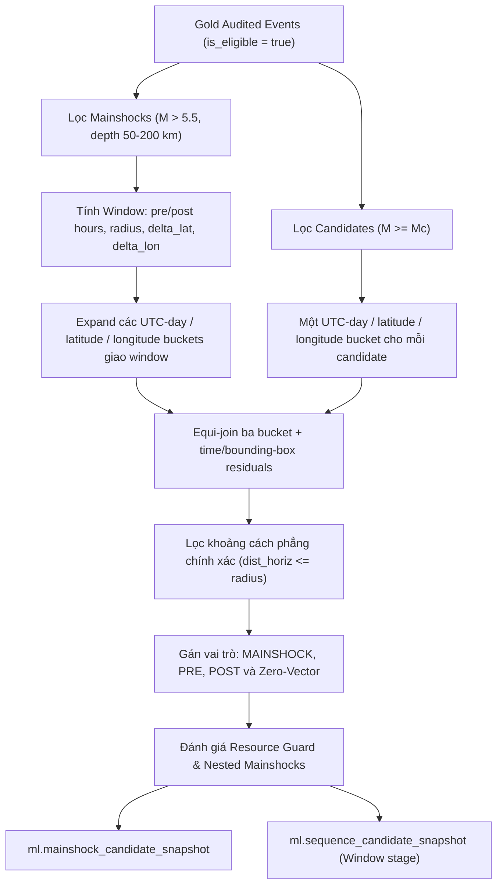

# Mainshock Selection và Candidate Window Generation Specification

Tài liệu này đặc tả quy trình kỹ thuật, mô hình toán học và cấu trúc dữ liệu cho việc chọn lọc động đất chính (mainshock) và tạo các cửa sổ ứng viên (candidate windows) theo hợp đồng dữ liệu `CON-03-ML` trong khuôn khổ task `MLD-03`.

---

## 1. Mục tiêu và Nguyên tắc Cốt lõi

1. **Giảm thiểu độ phức tạp tính toán:** Giảm catalog động đất thành các cửa sổ cục bộ theo từng mainshock để giữ lại nền địa chấn (background noise) phục vụ phân cụm, loại bỏ hoàn toàn tích Descartes không điều kiện (unqualified cross join) trên toàn lãnh thổ Nhật Bản.
2. **Bảo toàn hạt dữ liệu (Grain Invariant):**
   - Hạt của `ml.mainshock_candidate_snapshot`: `(dataset_id, mainshock_event_id)` là duy nhất.
   - Hạt của `ml.sequence_candidate_snapshot`: `(dataset_id, mainshock_event_id, candidate_event_id)` là duy nhất tuyệt đối.
3. **Bảo tồn tính toàn vẹn cửa sổ (Self-Inclusion):** Mỗi window phải chứa chính mainshock của nó đúng một lần với cờ `is_mainshock = true`, vai trò `relative_time_role = MAINSHOCK`, và vector tương đối bằng 0 tuyệt đối (`dx = dy = dz = distance_3d = delta_time = 0.0`).
4. **Hỗ trợ đa cửa sổ (Overlapping Windows):** Một sự kiện địa chấn có thể nằm trong nhiều cửa sổ của các mainshock khác nhau mà không bị coi là duplicate sai.
5. **Giám sát tài nguyên không nuốt lỗi (No Silent Truncation):** Khi số lượng candidate trong window vượt ngưỡng trần tài nguyên (`maxCandidatesPerWindow`), cửa sổ bị gắn cờ `FLAGGED` hoặc `REJECTED` kèm mã lý do `ML_RESOURCE_LIMIT_EXCEEDED`, không âm thầm cắt bớt dữ liệu.

---

## 2. Tiêu chí Chọn lọc Mainshock

Mainshock được chọn lọc từ tập dữ liệu Gold đã qua kiểm toán (`is_eligible = true` từ MLD-02) theo các tiêu chuẩn vật lý địa chấn:

| Thuộc tính | Điều kiện | Ý nghĩa / Cơ sở |
|---|---|---|
| `depth_km` | $50.0 \le \text{depth} \le 200.0\text{ km}$ (inclusive) | Giới hạn phân tầng trung gian (Intermediate depth) theo baseline nghiên cứu |
| `magnitude` | $> 5.5$ (exclusive) | Ngưỡng năng lượng đủ mạnh để phát sinh chuỗi dư chấn có ý nghĩa |
| `event_time_utc` | $[T_{\text{start}}, T_{\text{end}})$ | Nằm trong khoảng nửa mở của phân đoạn dataset (`REPRODUCTION` hoặc `EXTENSION`) |
| `catalog_era` | `UNIFIED` | Kỷ nguyên mạng lưới chuẩn hóa JMA (từ sau 1997) |
| `is_natural_earthquake` | `true` | Động đất tự nhiên |
| `is_in_study_area` | `true` | Nằm trong phạm vi quan sát Nhật Bản |

---

## 3. Mô hình Cửa sổ Không - Thời gian (Window Models)

Đặc tả hỗ trợ ba mô hình tính toán kích thước cửa sổ phụ thuộc magnitude:

### 3.1. Mô hình Uhrhammer (1986) — `wm_uhrhammer_v1.0`
- **Bán kính tìm kiếm ($d$):**
  $$d(M) = \exp(-1.024 + 0.804 \cdot M)\text{ km}$$
- **Thời gian sau mainshock ($t_{\text{post}}$):**
  $$t_{\text{post}}(M) = \exp(-2.870 + 1.235 \cdot M)\text{ days} \times 24.0\text{ hours}$$
- **Thời gian trước mainshock ($t_{\text{pre}}$):**
  $$t_{\text{pre}}(M) = \max(168.0\text{ h}, 0.1 \times t_{\text{post}}(M))$$

### 3.2. Mô hình Gardner & Knopoff (1974) — `wm_gardner_knopoff_v1.0`
- **Bán kính tìm kiếm ($L$):**
  $$L(M) = 10^{0.1238 \cdot M + 0.983}\text{ km}$$
- **Thời gian sau mainshock ($T_{\text{post}}$):**
  $$T_{\text{post}}(M) = 10^{0.5409 \cdot M - 0.547}\text{ days} \times 24.0\text{ hours}$$
- **Thời gian trước mainshock ($T_{\text{pre}}$):**
  $$T_{\text{pre}}(M) = \max(168.0\text{ h}, 0.1 \times T_{\text{post}}(M))$$

### 3.3. Mô hình Mở rộng — `wm_expanded_v1.0`
- Cho phép đặt trần an toàn (`maxSearchRadiusKm`, `maxPostWindowHours`, `maxPreWindowHours`) để tránh các trận siêu động đất (như Tohoku 2011 M9.0) tạo ra cửa sổ bao phủ toàn bộ catalog kéo dài hàng chục năm.

---

## 4. Chiến lược Range-Join và Bounding Box Prefilter

Để đảm bảo hiệu năng Spark và tránh Cross Join toàn catalog:



### 4.1. Toán tử Bounding Box

Bucket ngày dùng ngày UTC; spatial cell là `floor(latitude)` và
`floor(longitude)` (ô 1 độ). Mainshock window được expand bằng `sequence` và
`explode` tới tất cả bucket giao bounding box và interval; candidate chỉ thuộc
một bucket. Span ngày được clip theo period dataset trước khi expand, nhưng
exact window bounds không bị đổi. Mỗi cặp mainshock/event gặp nhau đúng một
lần; không cần deduplicate để che duplicate input. Sau equi-join vẫn áp dụng
đủ time/bounding-box/distance predicates. Ô có thể chứa candidate ngoài radius;
residual filters mới quyết định membership cuối cùng.

Physical plan phải dùng hash/sort-merge join trên ba keys, không được chứa
`CartesianProduct` hoặc `BroadcastNestedLoopJoin`. Test kiểm tra cả chế độ
broadcast mặc định và khi `spark.sql.autoBroadcastJoinThreshold=-1`.
Tại vĩ độ $\phi$ của mainshock:
- $\Delta\text{lat} = \frac{R}{110.57}^\circ$
- $\Delta\text{lon} = \min\left(180^\circ, \frac{R}{111.32 \cdot \cos(\text{radians}(\phi))}^\circ\right)$
Điều kiện lọc Range Join trên Spark SQL:
```sql
c.event_time_utc >= m.window_start_utc AND c.event_time_utc <= m.window_end_utc
AND c.latitude >= m.min_lat AND c.latitude <= m.max_lat
AND c.longitude >= m.min_lon AND c.longitude <= m.max_lon
```

### 4.2. Khoảng cách địa phương và Độ lệch thời gian
- $dx = 111.32 \cdot \cos(\text{radians}(\text{lat}_m)) \cdot (\text{lon}_c - \text{lon}_m)$ (km)
- $dy = 110.57 \cdot (\text{lat}_c - \text{lat}_m)$ (km)
- $dz = \text{depth}_c - \text{depth}_m$ (km)
- $d_{\text{horiz}} = \sqrt{dx^2 + dy^2} \le R$
- $d_{\text{3D}} = \sqrt{dx^2 + dy^2 + dz^2}$
- $\Delta t = \frac{T_c - T_m}{3600.0}$ (hours)

Spark tính window bounds bằng `timestamp_micros`/`unix_micros`; duration được
làm tròn tới microsecond. Delta lấy chênh lệch integer microseconds rồi chia
`3_600_000_000.0`, không cast từng timestamp xuống giây. Hai bounds inclusive;
period dataset vẫn half-open. Giây lẻ và event cách biên một microsecond được
kiểm thử riêng.

Self xác định theo ID, không theo timestamp: `MAINSHOCK` có vector bằng 0.
Non-self trước mainshock là `PRE` (delta âm), sau mainshock là `POST` (delta
dương). Nếu non-self đúng cùng timestamp, giữ event là `POST` với delta 0;
không bịa một độ lệch dương hoặc loại event hợp lệ. Đây chỉ là tie rule của
window stage, không khẳng định event đó là dư chấn. Downstream phải giữ rule
này khi đối chiếu membership.

### 4.3. Validation và artifact export

`MainshockWindowResult.assertInvariants()` kiểm tra grain, window count,
self presence, role/time/finite/zero-vector bằng Spark aggregation/join/filter;
chỉ số lượng hoặc boolean về driver. Engine chỉ collect metadata một row mỗi
window để tạo report, không collect toàn bộ candidates. Report metadata vẫn
có chi phí theo số windows; chưa có benchmark full historical ([QA-05 - Profile dữ liệu lịch sử và tài nguyên local](../task/tasks/QA-05.md)).

`MainshockWindowJob` ghi cả hai Parquet snapshots rồi readback counts trước
khi viết report thành công. Không có implicit JSON fallback hoặc
`catch(Throwable)`; storage/config error truyền ra caller. Trước rerun, hai
report cũ trong output scope bị invalidate để không còn success report giả.
Window `REJECTED` không được export. Không có atomic commit hai directory;
consumer không dùng sự tồn tại của một Parquet directory làm readiness gate.
Đây là local window artifacts, chưa phải Iceberg lifecycle/publication.

**Giới hạn:** MLD-02 - Audit Gold và xác định magnitude of completeness đã
Done theo Published JMA pilot. Pilot first256 không có mainshock; MLD-03 đã
nghiệm thu lại trên scoped14-day mainshock-centred sample có Published pins/Mc
thật: reproduction2 mainshocks/279 rows/Mc1.2, extension1/8/Mc0.9.
Không hard-code Mc=2 hoặc hạ ngưỡng magnitude/depth. Đây không phải full-period
training data; xem [evidence MLD-03](../evidence/MLD-03.md).
MLD-04 - Tạo và scale feature không-thời gian 4-D và MLD-05 - Validate feature
snapshot và export Parquet bundle phụ trách feature/export Colab; các artifacts
ở đây chưa thay thế hai task đó.

---

## 5. Cấu trúc Bảng Output

### 5.1. `ml.mainshock_candidate_snapshot`
| Field | Type | Nullable | Quy tắc |
|---|---|:---:|---|
| `schema_version` | string | Không | `"1.0"` |
| `dataset_id` | string | Không | Định danh bất biến của dataset |
| `mainshock_event_id` | string | Không | Canonical ID của mainshock |
| `event_time_utc` | timestamp | Không | Thời điểm xảy ra mainshock |
| `latitude` | double | Không | Tọa độ vĩ độ |
| `longitude` | double | Không | Tọa độ kinh độ |
| `depth_km` | double | Không | Độ sâu chấn tiêu (50–200 km) |
| `magnitude` | double | Không | Độ lớn (> 5.5) |
| `mc_value` | double | Không | Ngưỡng completeness áp dụng |
| `selection_rule_version` | string | Không | Phiên bản rule chọn mainshock |
| `window_model_version` | string | Không | Phiên bản mô hình cửa sổ |
| `pre_window_hours` | double | Không | Thời gian trước mainshock |
| `post_window_hours` | double | Không | Thời gian sau mainshock |
| `search_radius_km` | double | Không | Bán kính tìm kiếm |
| `candidate_count` | long | Không | Số ứng viên trong cửa sổ (gồm cả self) |
| `resource_guard_status` | string | Không | `"PASS"`, `"FLAGGED"`, hoặc `"REJECTED"` |
| `resource_reason_code` | string | Có | `"ML_RESOURCE_LIMIT_EXCEEDED"` khi vượt ngưỡng |
| `created_at_utc` | timestamp | Không | Thời điểm tạo snapshot |

### 5.2. `ml.sequence_candidate_snapshot` (Window stage)
Grain: `(dataset_id, mainshock_event_id, candidate_event_id)`

| Field | Type | Nullable | Quy tắc |
|---|---|:---:|---|
| `schema_version` | string | Không | `"1.0"` |
| `dataset_id` | string | Không | FK dataset manifest |
| `mainshock_event_id` | string | Không | FK mainshock snapshot |
| `candidate_event_id` | string | Không | Canonical ID của candidate |
| `candidate_time_utc` | timestamp | Không | Thời điểm candidate |
| `candidate_latitude` | double | Không | Vĩ độ candidate |
| `candidate_longitude` | double | Không | Kinh độ candidate |
| `candidate_depth_km` | double | Không | Độ sâu candidate |
| `candidate_magnitude` | double | Không | Độ lớn candidate ($\ge M_c$) |
| `mainshock_magnitude` | double | Không | Độ lớn của mainshock |
| `relative_time_role` | string | Không | `"MAINSHOCK"`, `"PRE"`, hoặc `"POST"` |
| `is_mainshock` | boolean | Không | `true` duy nhất cho self mainshock |
| `dx_km` | double | Không | Độ lệch đông-tây cục bộ (0.0 cho mainshock) |
| `dy_km` | double | Không | Độ lệch bắc-nam cục bộ (0.0 cho mainshock) |
| `dz_km` | double | Không | Độ lệch độ sâu cục bộ (0.0 cho mainshock) |
| `delta_time_hours` | double | Không | Độ lệch thời gian có dấu (0.0 cho mainshock) |
| `distance_3d_km` | double | Không | Khoảng cách không gian 3 chiều |
| `mc_value` | double | Không | Ngưỡng completeness áp dụng |
| `window_model_version` | string | Không | Phiên bản mô hình cửa sổ |
| `created_at_utc` | timestamp | Không | Thời điểm tạo |

## 6. Runtime exact-pin và nghiệm thu có thể chạy lại

`MainshockWindowJob` có CLI nhận một request JSON <=64KiB. Các fields gồm
`ml_namespace`, `dataset_id`, `dag_id`, `run_id`, `created_at_utc`,
`audit_handoff_path` (relative trong scoped staging), `audit_handoff_sha256`.
Caller giữ shared lease cho toàn run và cấp env Trino/Catalog/MinIO đã validate.
Job không nhận arbitrary Gold rows hoặc latest alias từ CLI.

`PinnedAuditResolver` dùng chung với MLD-02: đọc đúng một manifest BUILDING,
revalidate PASSED publication + đủ six snapshot pins + snapshot chưa expire,
đối chiếu immutable dataset identity và cutoff không trước publication.
Spark đọc physical `event_current` bằng `snapshot-id`, chạy lại audit/Mc rồi
đối chiếu toàn bộ identity, counts, applied Mc, canonical config/hash với handoff.
Dataset IDs/snapshot ID 64-bit không được round-trip bằng JavaScript Number.

Window version và **toàn bộ parameters** phải nằm trong pinned filter JSON:
`window_config` và `mainshock_selection_config`. CLI hỗ trợ ba baseline đã có
`wm_expanded_v1.0`, `wm_uhrhammer_v1.0`, `wm_gardner_knopoff_v1.0`; config không
khớp version bị reject. Manifest cũ chỉ ghi `window-model-v1` chưa đủ: phải tạo
identity mới có actual version/parameters, không sửa immutable identity tại chỗ.
So sánh config bằng canonical JSON text, không dùng trực tiếp Jackson
`JsonNode.equals`: small integer round-trip có thể thành IntNode thay LongNode
(hard-limit10000). Gate vẫn đối chiếu **toàn bộ** parameters, reject extra keys,
split không hỗ trợ hoặc đổi thresholds; không sửa pinned manifest để khớp code.
Window dimension UDF trả SQL null cho magnitude/latitude null/non-finite/out-of-range:
Catalyst có thể đánh giá UDF trước derived eligibility predicate. Rows này vẫn
bị audit/selection loại; không thay missing bằng0 hoặc đổi Mc/quality policy.
Regression dùng nullable schema và derived eligibility giống input Gold thật.

Job ghi hai local Parquet snapshots, đọc lại và kiểm tra grain/self/roles/vector
trên **readback rows**. Sorted row SHA-256 được stream qua driver (không collect
toàn candidates); semantic fingerprint bỏ `created_at_utc`. Artifact files có
checksum bytes riêng; rerun có thể đổi part filenames/physical bytes nhưng
logical fingerprints/counts/window configs phải giữ nguyên.

Chỉ `window-runtime-report.json` là completion gate của CLI, được invalidate
trước resolve/audit. File Parquet hoặc report của helper `run()` tồn tại không
chứng minh native run thành công. `window-manifest.json` là handoff, vẫn BUILDING,
không tự chuyển VALIDATED/EXPORTED và không ghi feature/aftershock labels vào Gold.

### 6.1. Published JMA QA có mainshock

`make test-ml-window` chạy offline Java/controller tests.
`make smoke-ml-window` preflight runner/image đã chuẩn bị và chạy opt-in service
`mainshock-window-qa`; không recreate service nền hoặc gọi lại USGS/JMA API.
Điều kiện: Foundation healthy, lease trống, exact Bronze objects từ
`airflow/dags/fixtures/slv_09_bronze_inputs.json` còn đọc được trên MinIO.
`MAINSHOCK_BRONZE_PINS` có thể chỉ định một receipt pins khác nhưng phải giữ
ba input USGS/JMA2000/JMA2023 đúng contract.
Smoke không build/start/init lại. Chuẩn bị bằng `make docker-build`, rồi
`make docker-up`; freshness SHA của host runner/Iceberg JAR được kiểm trước test.
Xem [Docker runtime workflow](../DOCKER_RUNTIME_WORKFLOW.md).

Luồng QA:

1. Fresh Bronze SHA/CRC/full structural count check. Không chỉ tin metadata Git.
2. Trong mỗi archive JMA, chọn first qualifying mainshock theo **physical order**,
   agency J, natural/UNIFIED/ROI, M>5.5/depth50–200, dateJan8..Dec24UTC để không
   vượt biên năm; lấy slice `[centre-7days, centre+7days)`. Parser giữ nguyên
   `member;line` locator và raw record hash. Scan tối đa400k lines/archive,
   tối đa15k selected+parse rejects/archive; vượt guard fail, không truncate.
   Temporal prefilter dùng origin-time parser của JMA; chỉ full-parse slice hoặc
   rows chưa xác định được time, không normalize cả năm trên driver. Structural
   CRC/full count vẫn verify cả archive. Parse rejects trong slice/không gán
   được thời gian được giữ conservative và báo count;
   không coi là rows hợp lệ trong slice. USGS16 là exclusion control.
   JMA parser `slv-03-v1.1` hỗ trợ signed padding degree I3/I4 như `- 1`,
   phát hiện từ pinned archive 2000; xem [parser mapping](./JMA_SILVER_PARSER.md).
   Không sửa Bronze bytes/hash, không loại agency U/I hoặc outside-ROI tại parser
   để làm quality gate xanh. Source URL chưa có trong provenance giữ null;
   không tự đoán URL từ tên archive.
3. Publish immutable SilverReady mới, commit/verify Gold trong **QA namespace mới**
   và empty baselines. Explicit allowed replacement months chỉ là2000/2023
   trong schema QA mới; không thay production gate COMPLETE_MONTHS hoặc Gold
   sản phẩm. Chạy lại writer/publisher để đối soát receipts.
4. Pin hai dataset manifests với actual window/config version, cutoff sau
   publication và QA code version `artifact_<runner SHA>`. Production phải pin
   commit/tag thật. Estimate Mc độc lập theo split từ MLD-02, không tune
   reproduction bằng extension.
5. Chạy CLI windows hai lần/split khi tắt broadcast, yêu cầu non-empty mainshock,
   self đúng một lần, PRE/POST thực, Parquet/invariants/fingerprints khớp và
   bucket join không Cartesian/BNLJ. Trino oracle độc lập dùng exact physical
   snapshot + period/Mc/mainshock/window predicates đối soát **từng window**
   và tổng PRE/MAINSHOCK/POST; không query current alias.
6. Python controller chỉ quản lý subprocess/lease/checksum; kiểm tra lại
   receipt/artifact SHA trước khi release own lease. `mld-03-report.json` chứa
   sources, six Gold pins/publication, manifests/audit, windows/oracle/rerun
   metadata, không raw dump. Scoped output ở
   `/opt/pipeline/staging/mainshock-window-qa/<run_id>/`.

Trino483 không hỗ trợ `date_diff('microsecond',...)`; MySQL-style `date_format`
trên runtime này làm mất fractional microseconds. Oracle lấy whole epoch seconds
từ `date_trunc('second',...)`, cộng fractional six-digit part của `to_iso8601`
thành integer epoch-micros rồi so sánh delta với pre/post bounds đã round xuống
đơn vị microsecond như Spark. Không chia hours bằng DECIMAL scale thấp hoặc
dùng unix-time DOUBLE để quyết định membership. Oracle giữ bounding-box residual
và horizontal distance tolerance0.00001km (1cm) giống engine, không chỉ distance.
Gate SELECT literals xác nhận delta±1µs qua biên ngày trước bất kỳ lake write;
`trino_microsecond_gate_passed=true` bắt buộc trong receipt. Tham chiếu
[Trino datetime/interval documentation](https://trino.io/docs/current/functions/datetime.html#interval-functions).

Nếu timeout/nonzero JVM/invalid receipt/artifact, lease giữ nguyên. Xác nhận
JVM/Trino đã dừng, đọc owner/request/receipts theo
[ORC-05 — Chốt recovery, concurrency và tài nguyên](../task/tasks/ORC-05.md);
không force unlock, xóa schema/warehouse/volume hoặc tự takeover run khác.
Nếu gate Silver fail trước bất kỳ publication, Java ghi
`silver-blocked-report.json` với status `BLOCKED_BEFORE_PUBLICATION`, counts,
reason histogram, bốn reconciliation checks và tối đa tám locator/hash/reason
samples, không full raw payload. File này chỉ phục vụ chẩn đoán, không thay
`mld-03-report.json` thành công và không cho downstream readiness.

### 6.1.1. Tiếp tục riêng windows sau lỗi, không ghi lại Gold

Nếu run đã có Published journal nhưng window lỗi: xác nhận JVM cũ dừng và own
lease vẫn giữ, build/test/package runner mới trước khi chạy
`make resume-ml-window QA_RUN_ID=<exact mld03-qa UUID run>`.
Target không tự build, không acquire/takeover lease, không seed Silver/Gold và
không xóa old artifacts. Namespace vẫn phải QA-only cùng suffix; Native
`--resume-windows` yêu cầu journal Published đã tồn tại, reverify six snapshot
pins bằng GoldPublisher existing-receipt path, Silver bundle SHA/quality/counts
và original Bronze pins bằng fresh readback. Foreign/missing lease, changed
code/source/pins hoặc receipt chưa PASSED đều fail closed.

Request Gold/source code_version cũ giữ nguyên; `window_code_version` phải khớp
SHA runner Java **thực đang chạy**. Dataset manifest mới pin builder code này
và cutoff mới, không sửa identity cũ. Output nằm trong scoped child
`<original_run>/resume-<UUID>/`, vẫn BUILDING/research_ready=false. Mỗi split
audit/Mc và native windows rerun hai lần, đối soát Trino/checksum như fresh QA.
Chỉ receipt hợp lệ hoàn chỉnh mới release own lease; lỗi vẫn giữ để điều tra.

### 6.2. Giới hạn và handoff

Slice14 ngày là **test pilot có selection bias**, không catalog toàn period
hoặc đầy đủ pre/post-duration của window model. Mc chỉ có scope này; guard>=50
không chứng minh completeness khoa học. Counts/windows của pilot không dùng
để đánh giá tỷ lệ dư chấn hay hiệu năng toàn lịch sử. Window size/radius/threshold
vẫn theo baseline; sample coverage không được diễn đạt như model clipping mới.

[MLD-04 — Tạo và scale feature không-thời gian 4-D](../task/tasks/MLD-04.md) và
[MLD-05 — Validate feature snapshot và export Parquet bundle](../task/tasks/MLD-05.md)
nhận `window-manifest.json`, exact pins/Mc/config/hash và hai Parquet snapshots;
chưa có feature vector hoặc Colab-ready bundle. Scheduled dataset DAG thuộc
[MLI-02 — Tạo Airflow DAG build ML dataset](../task/tasks/MLI-02.md); historical
coverage/resource benchmark thuộc [QA-03 — Kiểm thử JMA historical backfill](../task/tasks/QA-03.md)
và [QA-05 — Profile dữ liệu lịch sử và tài nguyên local](../task/tasks/QA-05.md).
