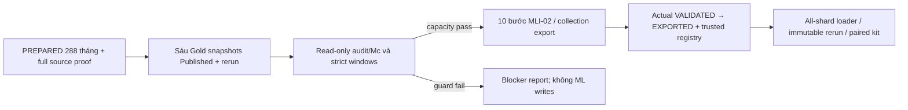

# DAT-03 — Official ML từ Published PREPARED

## Mục tiêu và phạm vi

Protocol `dat03-prepared-ml-v2` nối [Gold phần 2](PREPARED_GOLD_PUBLICATION.md)
đến MLI-02/MLD-05 collection exporter. Không sửa default DAG/runner, Gold,
legacy catalog gate hoặc lifecycle enums. Đây là explicit standalone execution,
không là scheduled/manual Airflow DagRun acceptance và không chạy model.

## Coverage proof riêng, không giả registry cũ

Chỉ opt-in `filter_config.source_coverage_contract` =
`dat03-published-prepared-coverage-v1`; field này và dataset config/code version
tham gia identity. Legacy config không tự mở coverage gate cho prepared Gold.

Adapter đọc original Gold commit, publication và request anchor từ object store,
không nhận caller rows/Mc/coverage-ready booleans. Yêu cầu:

1. Commit SHA = Published bundle SHA, actual PASSED status row, exact snapshot
   và physical table. Full scope của anchor phải bằng commit scope.
2. Stored publication giữ đúng identity/six-snapshot bundle, status/published;
   request/cutoff/counts/namespace và dataset reference phải khớp.
3. Verify lại toàn prepared file/footer/checkpoint/reconciliation chain, đủ
   288 tháng và fresh original-to-physical Bronze provenance như phần 1–2.
4. Chọn đúng 225/63 tháng theo split, JMA physical source URIs phải có proof;
   không suy completeness từ event min/max hoặc cờ tự khai.

Coverage trả về version mới, status COMPLETE và các SHA: prepared catalog,
prepared coverage, provenance, published commit, publication và Gold request.
**Không có `registry_sha256` legacy**, không tạo FullMonthReady/SilverReady,
`_SUCCESS` hoặc 288 legacy records giả. Collection planner/loader hiểu explicit
variant này; parent/dataset identity và shared source proof vẫn được pin.

`observation_cutoff_utc` là upper bound của manifest ML theo policy MLI-02, không
được trước publication hoặc period end. `source_cutoff_utc` gốc trong proof vẫn
giữ riêng: không tuyên bố source đã cập nhật tới ngày chạy ML và không đổi
source cutoff để khớp publication timestamp mới.

## Read-only capacity gate

Từ exact Published snapshot, Java chạy audit toàn split, MAXC/global Mc,
baseline mainshock selection, shared window engine và strict split. Không dùng
pilot, fixed Mc, sampling hoặc regenerate source. Window vượt split bị loại
nguyên cửa sổ với ID/required interval/reason như policy đã chốt.

V1 giữ guard 10.000 candidates/window. Owner đã duyệt thiết kế và kiểm chứng
**profile v2 tối đa 40.000/window**, không đổi dữ liệu hoặc science. V2 chỉ
prepare khi có external SHA của receipt `dat03-whole-window-40k-v1` đã đo trên
Java 17/Spark: full 40.000-row window, candidate fingerprint giữ nguyên so với
guard cũ, actual feature materialization/readback và immutable rerun. Benchmark
synthetic không là coverage/Mc/EXPORTED acceptance cho dữ liệu nghiên cứu.
Profile 40k gộp 29 null-field rules thành một Spark aggregation, vẫn kiểm từng
field theo cùng thứ tự/mã lỗi; không bỏ quality rule. Benchmark fault injection
kiểm null ở field đầu và cuối. Legacy profile giữ đường kiểm cũ. Số đo chỉ chứng
minh feature materialization/readback/rerun, không chứng nhận RAM/thời gian fit
DBSCAN/HDBSCAN trên 40.000 points.
Receipt phải pin đúng production runner SHA; prepare mới pin receipt/scaling
vào request/identity. Không sửa operation v1 đã đóng băng hoặc dùng receipt của
JAR cũ sau khi rebuild. V1 và legacy/default config không tự nâng cap.

Các guard còn lại giữ nguyên: 128 mainshocks và 100.000 feature rows/shard,
tối đa 64 shard/4.096 mainshock metadata. Window
FLAGGED/REJECTED khiến preflight `BLOCKED_RESOURCE`, không truncate/drop window
hoặc tự tăng limit. Counts/reasons/audit lưu lại; không ghi dataset ML để gọi
EXPORTED. Trên 40.000 vẫn bị chặn; cần quyết định và profile mới riêng, không
coi giới hạn shard 100.000 là quyền tăng giới hạn window.

Preflight chỉ SELECT, dùng own whole-run source lease để không tranh ETL.
Full audit hoàn tất trước khi cache lean seven-column window input bằng
DISK_ONLY. Đây là projection/resource optimization, không đổi eligible events,
Mc, window math, features hoặc scientific thresholds. Legacy preparation giữ
profile cũ; opt-in mới dùng projection tương tự ở actual collection preparation.

## Official build và checkpoint

Sau actual preflight accepted, exact report SHA được stage làm capacity pin.
Java kiểm lại Published/source proof và gọi 10 fixed steps `DatasetBuildJob`
protocol `mli-02-collection-v1`, không tự viết lifecycle/registry:

- Pin persisted BUILDING manifest; full-split audit/Mc, strict candidates và
  shared 29-column feature engine/whole-window collection assignment.
- Actual mainshock/candidate Iceberg commits, Trino pinned readbacks,
  BUILDING → VALIDATED → EXPORTED, immutable portable bundle và trusted registry.
- Final `mark_dataset_exported` chạy fresh exporter/TrustedDatasetResolver cho
  mọi shard trước khi chốt handoff, không chỉ đếm completed_steps=10.

ML namespace riêng `iceberg.dat03_ml_<operation_uuid>`, không dùng Gold namespace
hay default `iceberg.ml`. Hai split cùng source/cutoff/runner/scaling request,
dataset IDs riêng; chạy tuần tự. Config scaling hiện hành được giữ nguyên,
không fit/tune để làm input trông tốt hơn. EXPORTED là nghiệm thu kỹ thuật,
`scientific_approval=false`, `research_ready=false`.

Receipt/chain lưu theo split, kiểm contiguous prefix và plan/previous SHA trước
skip. Session 600..6000 giây, host overhead tối đa 180 giây; trước step mới cần
ít nhất 3600 giây còn lại. Đây là budget guard, không SLA hoàn tất phase;
timeout/unknown giữ evidence/lease, không retry mù. Clean CHECKPOINTED giữ đúng
own lease để session nối tiếp, không acquire lại nếu checkpoint mất lease.
Host start reserve 12 GiB, run >=10 GiB và actual physical reserve 4 GiB được
theo dõi; không lấy VM logical free thay host physical free.

Rerun cần full prefix và chỉ SELECT ở Trino. Exporter phải reuse same exact
mainshock/candidate/registry pins và manifest/checksum SHA; artifact hỏng/mất
không được regenerate để che lỗi. Không thay default historical alias/Gold.

## Bàn giao và giới hạn

[Loader/paired kit](RESEARCH_TEAM_KIT.md) dùng actual trusted portable pins,
đọc tuần tự mọi shard, không concat toàn dataset vào RAM. Root registry là
handoff của đúng ML namespace/operation, không copy marker vào registry default
để giả acceptance. Import/evaluation các task MLI-03/MLQ-01/EXP-02..05 vẫn cần
đúng scoped config và scientific gates riêng.

DAT-03 chưa Done chỉ vì code/preflight hoặc hai export chạy được. Còn actual
all-shard verification/rerun, immutable release và receipt thật ba máy; không
tạo hộ receipt ThanhTris/rosy179. Cloud transfer không được thay ACL hoặc đưa
credential/private logs/warehouse vào kit. Xem [runbook](../runbooks/DAT-03_PREPARED_ML.md).
